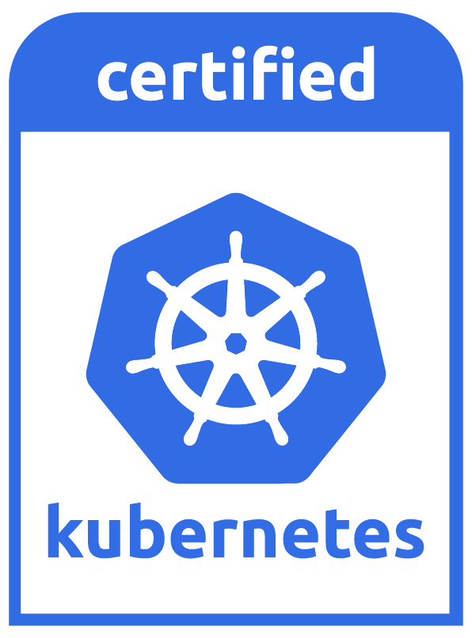

# Über unser Managed Kubernetes
Wir stellen einen gehosteten, CNCF-zertifizierten Kubernetes-Cluster bereit, der auf Ihre Anforderungen zugeschnitten ist. Anders als bei Self-Service-Angeboten für Kubernetes übernehmen wir die volle Verantwortung für das Erstellen, Aktualisieren und Verwalten Ihrer Kubernetes-Cluster. Wenn der Cluster eingerichtet ist, erhalten Sie von uns eine kubeconfig-Datei. Mit dieser Datei haben Sie sicheren Zugriff auf den Cluster.

# Was wir für Sie verwalten
Als Teil unseres Managed-Kubernetes-Service übernehmen wir die folgenden Aufgaben:

- Erstellen des Clusters: Wir richten einen Kubernetes-Cluster ein, der die Standards der CNCF-Zertifizierung erfüllt. So stellen wir die Kompatibilität mit den neuesten Kubernetes-Versionen sicher.
- Aktualisieren des Clusters: Wir aktualisieren den Cluster regelmäßig auf die neueste stabile Version. So verbessern wir Sicherheit und Performance.
- Verwalten des Clusters: Wir überwachen den Zustand und die Performance der Control Plane des Clusters.

Wir verwalten diese Kernelemente. So können Sie sich auf Ihre Anwendungen konzentrieren und müssen sich nicht um die Komplexität des Kubernetes-Betriebs kümmern.

Wenn ein Problem auftritt, erreichen Sie uns [hier](/managedk8s/about/support/).

# Erste Schritte
## Schritt 1: Erhalten Sie Ihre kubeconfig-Datei
Wenn Ihr Kubernetes-Cluster bereit ist, erhalten Sie von uns eine kubeconfig-Datei. Diese Datei enthält die Zugangsdaten und die Verbindungsdetails für den Zugriff auf den Cluster.

## Schritt 2: Installieren Sie das Kommandozeilenwerkzeug kubectl
Für die Arbeit mit Ihrem Managed-Kubernetes-Cluster müssen Sie kubectl installieren. kubectl ist das Kommandozeilenwerkzeug von Kubernetes.

Installationsanleitung:
- Unter macOS: `brew install kubectl`
- Unter Windows: Laden Sie die ausführbare Datei von Kubernetes Releases herunter.
- Unter Linux: Verwenden Sie den Paketmanager Ihrer Distribution oder laden Sie kubectl von Kubernetes Releases herunter.

## Schritt 3: Konfigurieren Sie kubectl für die bereitgestellte kubeconfig
Wenn kubectl installiert ist, konfigurieren Sie es für die bereitgestellte kubeconfig-Datei:

Speichern Sie die kubeconfig-Datei an einem sicheren Ort auf Ihrem lokalen Rechner.

Setzen Sie die Umgebungsvariable KUBECONFIG auf den Pfad Ihrer kubeconfig-Datei:
```bash 
export KUBECONFIG=/path/to/your/kubeconfig

# Verify the configuration by running:
# This command will display the details of your current Kubernetes configuration.
kubectl config view 
```

## Schritt 4: Greifen Sie auf Ihren Cluster zu
Sie können jetzt mit kubectl-Befehlen auf Ihrem Managed-Kubernetes-Cluster arbeiten. Mit den folgenden grundlegenden Befehlen können Sie beginnen:

Nodes des Clusters prüfen:

```bash 
kubectl get nodes
```
Namespaces auflisten:

```bash 
kubectl get namespaces
```
Anwendungen bereitstellen:

Um Anwendungen bereitzustellen, erstellen Sie Kubernetes-Manifeste (YAML-Dateien). Diese Manifeste definieren die Konfiguration Ihrer Anwendung (Deployments, Services usw.). Wenden Sie die Manifeste auf den Cluster an:


```bash 
kubectl apply -f your-deployment-file.yaml
```

## Zertifizierungen



Unser Managed-Kubernetes-Service ist ein Produkt, mit dem Sie Kubernetes-Cluster in der WIIT Cloud effizient einrichten und betreiben.
Kunden können einen Managed-Kubernetes-Cluster verwenden, der die Konformitätsprüfungen und Anforderungen der
[Cloud Native Computing Foundation](https://cncf.io/ck) erfüllt.

Die Konformitätsergebnisse unserer Plattform können Sie unter
[CNCF Kubernetes Conformance](https://github.com/cncf/k8s-conformance) prüfen.
