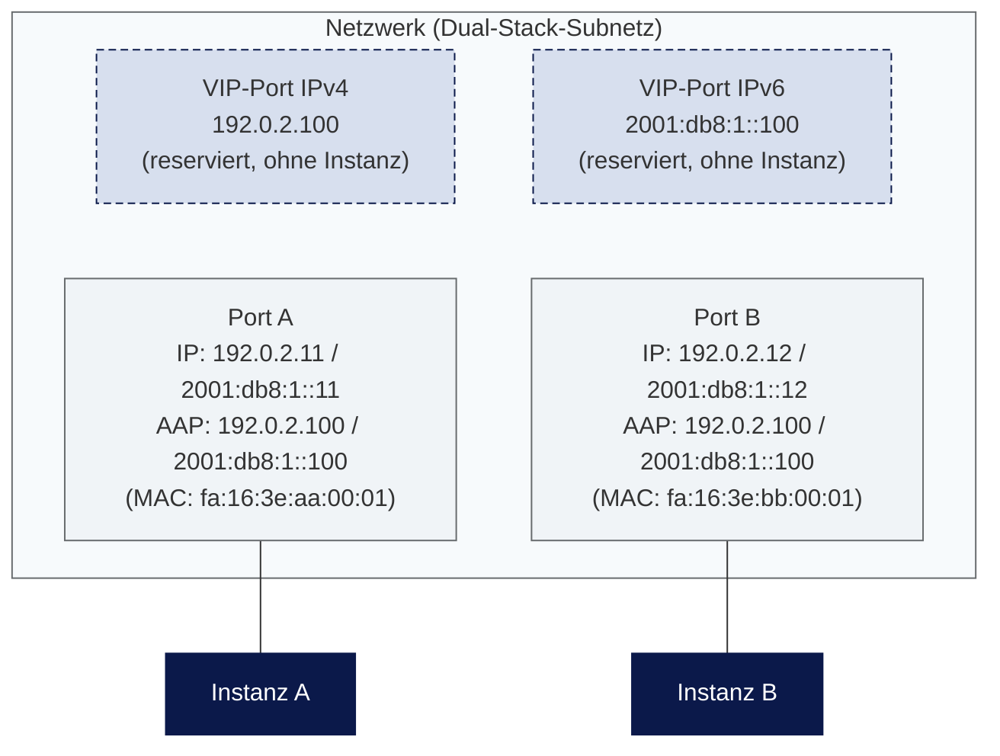

HA-Cluster
==========

Für den Betrieb eines HA-Clusters mit einer gemeinsamen virtuellen IP (VIP) — zum Beispiel mit keepalived, Corosync/Pacemaker oder herstellerspezifischen HA-Mechanismen — sind auf der OpenStack-Plattform die folgenden Punkte zu beachten.

Wenn Lastverteilung das eigentliche Ziel ist, sind [Octavia Loadbalancer](/openstack/networking/octavia_loadbalancer/) eine managed Alternative, die ohne einen eigenen HA-Cluster auskommt.

Security-Group-Regel für VRRP
---------------

Um [VRRP](https://de.wikipedia.org/wiki/Virtual_Router_Redundancy_Protocol) nutzen zu können, muss dies in einer Security-Group aktiviert und dann den jeweiligen Instanzen zugeordnet werden. Aktuell ist dies nur mit dem OpenStack-Client möglich, zum Beispiel:

```bash
openstack security group rule create --remote-ip 10.0.0.0/24 --protocol vrrp --ethertype IPv4 --ingress default
```

Analog wird für IPv6 eine Regel mit `--ethertype IPv6` benötigt, zum Beispiel:

```bash
openstack security group rule create --remote-ip 2001:db8:1::/64 --protocol vrrp --ethertype IPv6 --ingress default
```

VIP-Port und Allowed Address Pairs
---------------

Um die VIP in Neutron zu reservieren, wird ein virtueller Port für die VIP erzeugt:

```bash
openstack port create --network <NETWORK_ID> --fixed-ip subnet=<SUBNET_ID>,ip-address=<VIP_IP_CIDR> VIP_PORT
```

Wenn mehrere VIPs (zum Beispiel in einem Netzwerk mit IPv4- und IPv6-Subnetzen) genutzt werden sollen, ist für jede VIP ein eigener virtueller Port anzulegen.

Zusätzlich zum virtuellen Port ist es notwendig, die VIP als Allowed Address Pair für die Ports der jeweiligen Instanzen zu konfigurieren. Damit teilt man der Plattform mit, dass diese Ports erwartet werden, die IP-Adresse des VIP-Ports zu verwenden:

```bash
openstack port set <PORT_UUID> --allowed-address ip-address=<VIP_IP_CIDR>,mac_address=<MAC_ADDRESS>
```

`<MAC_ADDRESS>` muss dabei die echte MAC-Adresse des jeweiligen Interfaces sein, da virtuelle MAC-Adressen von der Plattform nicht unterstützt werden.

Das folgende Diagramm zeigt das Zusammenspiel von VIP-Ports, Instanz-Ports und Allowed Address Pairs am Beispiel eines Dual-Stack-Clusters mit zwei Knoten:

<svg width="0" height="0" style="position:absolute"><defs><pattern id="hatch-light" width="6" height="6" patternUnits="userSpaceOnUse" patternTransform="rotate(45)"><rect width="6" height="6" fill="#f7fafc"/><line x1="0" y1="0" x2="0" y2="6" stroke="#aeb4bd" stroke-width="1"/></pattern></defs></svg>

<style>
.mermaid .cluster rect { fill: url(#hatch-light) !important; }
</style>



{: .warning }

> Virtuelle MAC-Adressen werden von der Plattform grundsätzlich nicht unterstützt. Die Interfaces müssen daher ihre echte MAC-Adresse verwenden. Bei einem VIP-Failover ändert sich die MAC-Adresse der VIP entsprechend. Dieses Verhalten ist bei manchen Herstellern unter dem Begriff _Unicast HA_ (Unicast Heartbeat) bekannt.

Erreichbarkeit der VIP bei Nutzung einer Floating IP
---------------

Instanzen können auf der OpenStack-Plattform jederzeit aufgrund von Wartungsarbeiten, Lastverteilung oder Hardware-Ausfällen zwischen einzelnen Hypervisoren verschoben werden.

Wenn einer VIP eine FIP zugewiesen ist und nur die FIP genutzt wird, kann es unter gewissen Umständen zur Nichterreichbarkeit der FIP kommen. Ursachen hierfür können bspw. viele Arbeitsspeicherzugriffe während der Migration sein.

Wir raten daher, in solchen Setups regelmäßig GARP zu senden:

Beispiel für keepalived:

```conf
# /etc/keepalived/keepalived.conf

# minimum time interval for refreshing gratuitous ARPs while MASTER
vrrp_garp_master_refresh 10  # secs, default 0 (no refreshing)

# number of gratuitous ARP messages to send at a time while MASTER
vrrp_garp_master_refresh_repeat 2 # default 1
```

Beispiel für Corosync / Pacemaker:

```bash
sudo pcs resource update res_ip arp_count_refresh=1 arp_bg=true
```

Die Plattform selbst reagiert auf Hypervisor-Ausfälle mit einem automatischen Rescheduling der betroffenen Instanzen. Details hierzu finden sich im [FAQ](/openstack/faq/#wie-werden-hypervisor-ausfälle-gehandhabt-und-wie-kann-ich-das-verhalten-beeinflussen).
