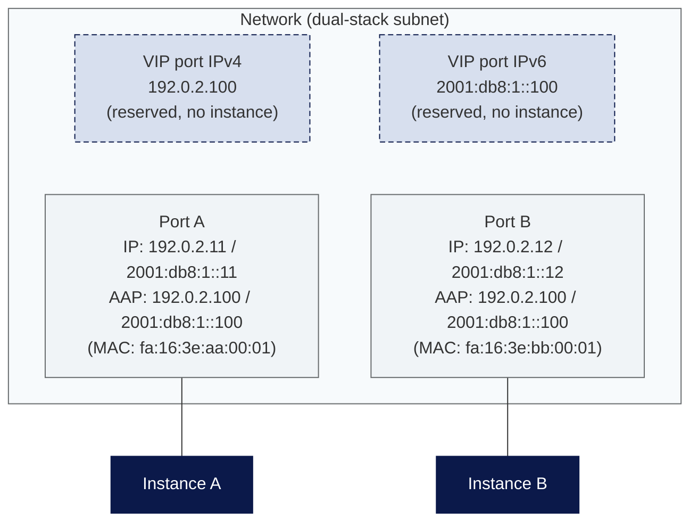

HA Clusters
===========

For operating an HA cluster with a shared virtual IP (VIP) — for example using keepalived, Corosync/Pacemaker or vendor-specific HA mechanisms — the following aspects of the OpenStack platform have to be considered.

If load balancing is the actual goal, [Octavia Load Balancers](/openstack/networking/octavia_loadbalancer/) provide a managed alternative that does not require your own HA cluster.

Security group rule for VRRP
---------------

To use [VRRP](https://en.wikipedia.org/wiki/Virtual_Router_Redundancy_Protocol), it must first be enabled in a security group, which is then assigned to an actual VM. You can only add this with the OpenStack client. For example:

```bash
openstack security group rule create --remote-ip 10.0.0.0/24 --protocol vrrp --ethertype IPv4 --ingress default
```

Similarly, IPv6 requires a rule with `--ethertype IPv6`, for example:

```bash
openstack security group rule create --remote-ip 2001:db8:1::/64 --protocol vrrp --ethertype IPv6 --ingress default
```

VIP port and allowed address pairs
---------------

To reserve the VIP in Neutron, a virtual port is created for the VIP:

```bash
openstack port create --network <NETWORK_ID> --fixed-ip subnet=<SUBNET_ID>,ip-address=<VIP_IP_CIDR> VIP_PORT
```

If multiple VIPs are to be used (for example in a network with IPv4 and IPv6 subnets), a separate virtual port must be created for each VIP.

In addition to the virtual port, you need to configure the VIP as an allowed address pair on your instance ports. This tells the platform that these ports are expected to use the IP address of the VIP port:

```bash
openstack port set <PORT_UUID> --allowed-address ip-address=<VIP_IP_CIDR>,mac_address=<MAC_ADDRESS>
```

`<MAC_ADDRESS>` must be the real MAC address of the respective interface, as virtual MAC addresses are not supported by the platform.

The following diagram shows how the VIP ports, the instance ports and the allowed address pairs interact, using the example of a two-node dual-stack cluster:

<svg width="0" height="0" style="position:absolute"><defs><pattern id="hatch-light" width="6" height="6" patternUnits="userSpaceOnUse" patternTransform="rotate(45)"><rect width="6" height="6" fill="#f7fafc"/><line x1="0" y1="0" x2="0" y2="6" stroke="#aeb4bd" stroke-width="1"/></pattern></defs></svg>

<style>
.mermaid .cluster rect { fill: url(#hatch-light) !important; }
</style>



{: .warning }

> Virtual MAC addresses are not supported by the platform at all. The interfaces therefore have to use their real MAC addresses. A VIP failover then changes the MAC address of the VIP accordingly. With some vendors, this behavior is known as _Unicast HA_ (unicast heartbeat).

VIP reachability when using a floating IP
---------------

Instances on the OpenStack platform can be moved between individual hypervisors at any time due to maintenance, load balancing, or hardware failures.

If a VIP is assigned a FIP and only the FIP is being used, the FIP may become unreachable under certain circumstances. This can be caused, for example, by numerous memory accesses during migration.

We therefore recommend sending GARP messages regularly in such setups:

Example for keepalived:

```conf
# /etc/keepalived/keepalived.conf

# minimum time interval for refreshing gratuitous ARPs while MASTER
vrrp_garp_master_refresh 10 # secs, default 0 (no refreshing)

# number of gratuitous ARP messages to send at a time while MASTER
vrrp_garp_master_refresh_repeat 2 # default 1
```

Example for Corosync / Pacemaker:

```bash
sudo pcs resource update res_ip arp_count_refresh=1 arp_bg=true
```

The platform itself responds to hypervisor outages by automatically rescheduling the affected instances. Details can be found in the [FAQ](/openstack/faq/#how-are-hypervisor-outages-handled-and-how-can-i-influence-the-behavior).
