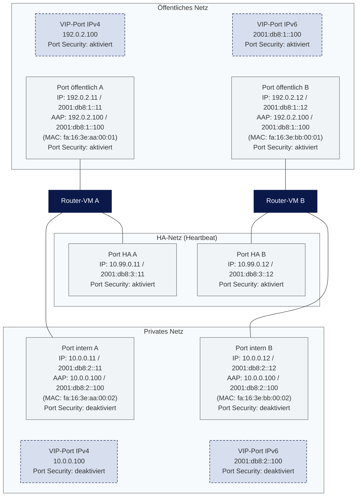

Router-VMs
==========

Wenn Sie Datenverkehr über eine Router-VM routen möchten, müssen Sie Port Security auf den betroffenen Ports deaktivieren. Andernfalls werden Pakete verworfen, wenn weder die Quell- noch die Ziel-IP-Adresse des Pakets der IP-Adresse des Ports selbst oder einer IP-Adresse aus den Allowed Address Pairs entspricht.

Für den HA-Betrieb der Router-VMs (VIP-Port, Allowed Address Pairs, echte MAC-Adressen) gelten die Hinweise auf der Seite [HA-Cluster](/openstack/networking/ha_cluster/).

Wenn ausschließlich ein Site-to-Site-VPN zwischen zwei Netzwerken benötigt wird, ist [VPN as a Service](/openstack/networking/vpnaas/) eine Alternative, die ohne eigene Router-VMs auskommt.

Das folgende Diagramm zeigt ein typisches Dual-Stack-Setup mit zwei Router-VMs, die jeweils ein öffentliches, ein internes und ein HA-Interface haben:

<svg width="0" height="0" style="position:absolute"><defs><pattern id="hatch-light" width="6" height="6" patternUnits="userSpaceOnUse" patternTransform="rotate(45)"><rect width="6" height="6" fill="#f7fafc"/><line x1="0" y1="0" x2="0" y2="6" stroke="#aeb4bd" stroke-width="1"/></pattern></defs></svg>

<style>
.mermaid .cluster rect { fill: url(#hatch-light) !important; }
</style>



Port Security deaktivieren
---------------

Ein typisches HA-Setup mit zwei Router-VM-Instanzen besteht pro Instanz aus einem öffentlichen Interface, einem privaten (internen) Interface und gegebenenfalls einem HA-Interface.

In diesem Szenario muss Port Security auf dem internen Interface deaktiviert werden, da dieses den Datenverkehr routet. Auf dem HA-Interface und dem öffentlichen Interface wird üblicherweise nicht geroutet, daher ist eine Deaktivierung dort nicht notwendig:

```bash
openstack port set --disable-port-security <PORT_UUID>
```

Hinweis: Bei deaktivierter Port Security werden die Security Groups des Ports nicht mehr angewendet.
