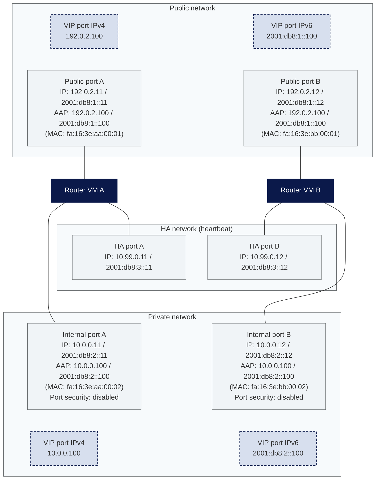

Router VMs
==========

If you want to route traffic through a router VM, you have to disable port security on the affected ports. Otherwise, packets are dropped when neither the source nor the destination IP address in the packet matches the IP address of the port itself or an IP address in the allowed address pairs.

For operating the router VMs in HA mode (VIP port, allowed address pairs, real MAC addresses), the notes on the [HA Clusters](/openstack/networking/ha_cluster/) page apply.

If all you need is a site-to-site VPN between two networks, [VPN as a Service](/openstack/networking/vpnaas/) is an alternative that does not require dedicated router VMs.

The following diagram shows a typical dual-stack setup with two router VMs, each with a public, an internal and an HA interface:

<svg width="0" height="0" style="position:absolute"><defs><pattern id="hatch-light" width="6" height="6" patternUnits="userSpaceOnUse" patternTransform="rotate(45)"><rect width="6" height="6" fill="#f7fafc"/><line x1="0" y1="0" x2="0" y2="6" stroke="#aeb4bd" stroke-width="1"/></pattern></defs></svg>

<style>
.mermaid .cluster rect { fill: url(#hatch-light) !important; }
</style>



Disable port security
---------------

A typical HA setup with two router VM instances consists of a public interface, a private (internal) interface and, optionally, an HA interface per instance.

In this scenario, port security must be disabled on the internal interface, as this is where traffic is routed. The HA interface and the public interface usually do not route any traffic, so disabling port security is not necessary there:

```bash
openstack port set --disable-port-security <PORT_UUID>
```

Note: With port security disabled, the security groups of the port are no longer applied.
