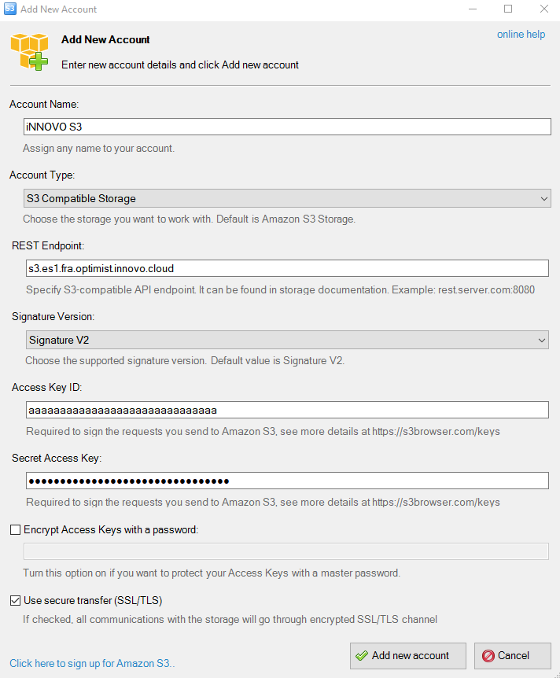
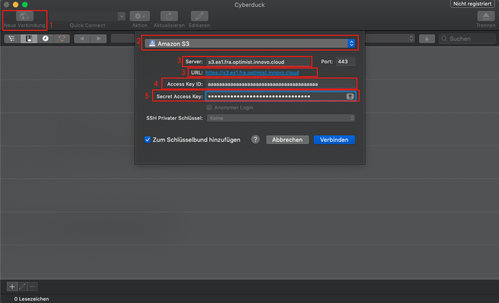

# Create and Use S3 Credentials

**Contents:**

- [Create S3 credentials](#create-s3-credentials)
- [Entering User Data in the Configuration File](#entering-user-data-in-the-configuration-file)
  - [S3cmd](#s3cmd)
  - [S3Browser](#s3browser)
  - [Cyberduck](#cyberduck)
  - [Boto3](#boto3)
- [Show S3 credentials](#show-s3-credentials)
- [Delete S3 credentials](#delete-s3-credentials)

## Create S3 credentials

In order to access Object Storage, we first need login data (credentials).
To generate this data via the OpenStack API, we need to use the OpenStack client and execute the following command there:

`$ openstack ec2 credentials create`

If the data has been created correctly, The output will be similar to the below:

```bash
$ openstack ec2 credentials create
+------------+-----------------------------------------------------------------+
| Field      | Value                                                           |
+------------+-----------------------------------------------------------------+
| access     | aaaaaaaaaaaaaaaaaaaaaaaaaaaaaaa                                 |
| links      | {u'self': u'https://identity.openstack.de-west-01.wiit-cloud.io/v3/users/bbb |
|            | bbbbbbbbbbbbbbbbbbbbbbbbbbbbb/credentials/OS-                   |
|            | EC2/aaaaaaaaaaaaaaaaaaaaaaaaaaaaaaa'}                           |
| project_id | cccccccccccccccccccccccccccccccc                                |
| secret     | dddddddddddddddddddddddddddddddd                                |
| trust_id   | None                                                            |
| user_id    | bbbbbbbbbbbbbbbbbbbbbbbbbbbbbbbb                                |
+------------+-----------------------------------------------------------------+
```

Once the credentials are available, we need a way to access the S3-compatible Object Storage.
There are different options for this; in this documentation, we present four: [S3cmd](https://s3tools.org/s3cmd) for Linux/macOS, [S3Browser](https://s3browser.com/) for Windows, [Cyberduck](https://cyberduck.io/) and [Boto3](https://boto3.amazonaws.com/v1/documentation/api/latest/index.html).

## Entering User Data in the Configuration File

### S3cmd

To install s3cmd, we need a package manager such as "pip". The installation and usage are explained in the [OpenStack Client / CLI](/openstack/quickstart/osclient/) guide.
Once pip is installed, the command for the installation of S3cmd is then:

`$ pip install s3cmd`

After the successful installation of S3cmd, the previously created credentials must be entered into the S3cmd configuration file.
The file responsible for this is ".s3cfg", which is located in the home directory by default. If this file does not yet exist, it must first be created.

We then enter the following data in the .s3cfg and save it:

```ini
access_key = aaaaaaaaaaaaaaaaaaaaaaaaaaaaaaaaaaaaaaa
check_ssl_certificate = True
check_ssl_hostname = True
host_base = s3.openstack.de-west-01.wiit-cloud.io
host_bucket = s3.openstack.de-west-01.wiit-cloud.io
secret_key = dddddddddddddddddddddddddddddddd
use_https = True
```

### S3Browser

The S3Browser can be downloaded [here](https://s3browser.com/) and easily installed afterwards.
After this has been successfully installed, we then need to enter all necessary credentials.
To do this, we open the S3Browser and the following window opens automatically the first time we run the application:



Here we enter the following values and click on "Add new account".

```text
* Account Name: Freely selectable name for the account.
* Account Type: S3 Compatible Storage
* REST Endpoint: s3.openstack.de-west-01.wiit-cloud.io
* Signature Version: Signature V2
* Access Key ID: The corresponding Access Key (in our example: ddddddddddddddddddddddddddddddddddddd)
* Secret Access Key: The corresponding secret (in our example: ddddddddddddddddddddddddddddddddddddd)
```

### Cyberduck

To use Cyberduck, it is first necessary to download the application [here](https://cyberduck.io/).
After installing and running the program for the first time, click on "New connection". (1)
A new window opens in which "Amazon S3" is selected in the dropdown menu (2). The following data is then required:

- Server(3): s3.openstack.de-west-01.wiit-cloud.io
- Access Key ID(4): The corresponding Access Key (in our example: ddddddddddddddddddddddddddddddddddddd)
- Secret Access Key(5): The corresponding Secret (in our example: dddddddddddddddddddddddddddddddddd)



Finally, to establish a connection, click on "Connect".

### Boto3

To install Boto3, we need a package manager such as "pip". The installation and usage of pip is explained in the [OpenStack Client / CLI](/openstack/quickstart/osclient/) guide.
Once pip is installed, the command for the installation of Boto3 is then:

`$ pip install boto3`

After the successful installation, Boto3 is ready to use; it is important to note that Boto3 is used via a script, which is executed at the end.
Therefore, the configuration section shown below is always part of the scripts used later.
For this, we create a Python file such as "Example.py" and add the following content:

- endpoint_url: s3.openstack.de-west-01.wiit-cloud.io
- aws_access_key_id: The corresponding Access Key (in our example: dddddddddddddddddddddddddddddddddddd)
- aws_secret_access_key: The corresponding Secret (in our example: dddddddddddddddddddddddddddddddddd)

```python
#!/usr/bin/env/python

import boto3
from botocore.client import Config

s3 = boto3.resource('s3',
                        endpoint_url='https://s3.openstack.de-west-01.wiit-cloud.io',
                        aws_access_key_id='aaaaaaaaaaaaaaaaaaaaaaaaaaaaaaaaaaaaaaa',
                        aws_secret_access_key='dddddddddddddddddddddddddddddddd',
                    )
```

This serves as a starting point and is referenced and used in the following scripts.

## Show S3 credentials

In order to show existing Object Storage EC2 credentials, we need to use the OpenStack client and execute the following command there:

`$ openstack ec2 credentials list`

The output will be similar to the below:

```bash
$ openstack ec2 credentials list
+----------------------------------+----------------------------------+----------------------------------+----------------------------------+
| Access                           | Secret                           | Project ID                       | User ID                          |
+----------------------------------+----------------------------------+----------------------------------+----------------------------------+
| aaaaaaaaaaaaaaaaaaaaaaaaaaaaaaaa | xxxxxxxxxxxxxxxxxxxxxxxxxxxxxxxx | 12341234123412341234123412341234 | 32132132132132132132132132132132 |
| bbbbbbbbbbbbbbbbbbbbbbbbbbbbbbbb | yyyyyyyyyyyyyyyyyyyyyyyyyyyyyyyy | 56756756756756756756756756756756 | 65465465465465465465465465465465 |
| cccccccccccccccccccccccccccccccc | zzzzzzzzzzzzzzzzzzzzzzzzzzzzzzzz | 89089089089089089089089089089089 | 09809809809809809809809809809809 |
+----------------------------------+----------------------------------+----------------------------------+----------------------------------+
```

## Delete S3 credentials

In order to delete Object Storage EC2 credentials, we need to use the OpenStack client and execute the following command there:

`$ openstack ec2 credentials delete <access-key>`
